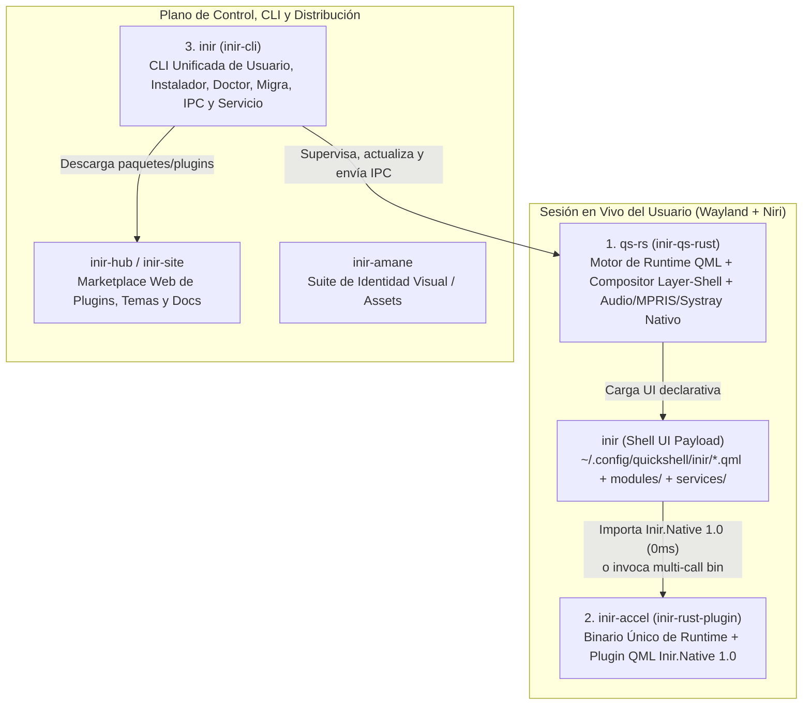
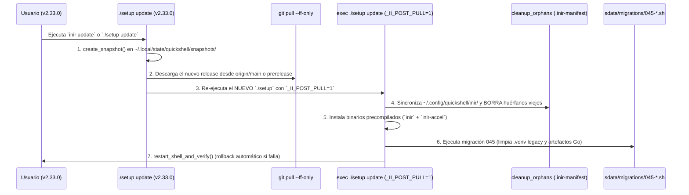

# iNiR Ecosystem Architecture & Zero-Bloat Transition Blueprint (`v2.33.0` → Next Release)

> **Author / Attribution**: `This code was written by: Hikari.`
> **Scope**: Complete audit of how `inir` is distributed to the public (`public/main` at `v2.33.0`) vs the local `prerelease` development branch (`HEAD`, 250 commits ahead), exact role correlation across all `inir` repositories, and the step-by-step safe transition plan for `inir update`.

---

## 1. Correlación de todos los proyectos del ecosistema iNiR

Hoy existen 6 repositorios en `/home/user/` que conforman el ecosistema completo de **iNiR**. Para eliminar la fricción y el bloat de cientos de scripts sueltos, cada proyecto pasa a cumplir un rol estrictamente delimitado y se reduce a **3 binarios nativos en el sistema del usuario**:

| Proyecto | Ubicación Local | Rol Exacto en el Futuro | Qué Reemplaza / Elimina |
| :--- | :--- | :--- | :--- |
| **`inir`** (Shell UI) | [`/home/user/inir`](file:///home/user/inir) | **Sólo UI declarativa QML (`modules/`, `services/`), traducciones, `defaults/` y manifiestos de migración.** | Deja de distribuir código fuente Go (`scripts/colors/*_themegen`), decenas de scripts Python pesados y `.venv` de 340 MB. |
| **`inir-rust-plugin`** (`inir-accel` + `libinir_qml_plugin.so`) | [`/home/user/inir-rust-plugin`](file:///home/user/inir-rust-plugin) | **El Binario Único de Runtime (`inir-accel`) + Plugin QML (`Inir.Native 1.0`).** Ejecuta todo el cómputo pesado en vivo: Washi v30, Material You + APCA-W3, visión de wallpaper (`least_busy_region`), miniaturas (`thumbgen`), generadores de temas (terminales, VSCode/Cursor/Antigravity, Zed, OpenCode, System24/Vesktop, Claude Code), Cava audio/cover, sanitizador de portapapeles y telemetría `/proc` + `hwmon`. | Reemplaza **5 binarios Go compilados en runtime** y **11 scripts Python + el `.venv` de 340 MB** (`pillow`, `materialyoucolor`, `numpy`). |
| **`inir-qs-rust`** (`qs-rs`) | [`/home/user/inir-qs-rust`](file:///home/user/inir-qs-rust) | **El Motor de Ejecución QML/Wayland.** Reemplazo en Rust del binario `qs` (Quickshell C++), proveyendo `Quickshell.*`, `Quickshell.Io`, `Quickshell.Wayland`, `Quickshell.Services.Mpris/Pipewire/SystemTray` y Polkit nativo. | Elimina la dependencia de compilaciones C++ frágiles de `quickshell-git` en AUR/distros. |
| **`inir-cli`** (`inir`) | [`/home/user/inir-cli`](file:///home/user/inir-cli) | **El Plano de Control y Gestor del Ciclo de Vida.** Binario `/usr/bin/inir` o `~/.local/bin/inir` que maneja `inir run/restart/logs/doctor/settings/theme/wallpaper/update/rollback/migrate`. | Reemplaza el launcher bash monolítico `scripts/inir` y orquesta a futuro las etapas de `./setup`. |
| **`inir-hub` & `inir-site`** | [`/home/user/inir-hub`](file:///home/user/inir-hub), [`/home/user/inir-site`](file:///home/user/inir-site) | **Ecosistema Web y Registro de Plugins/Temas.** | Evita engordar el repositorio principal `inir` con temas/packs opcionales. |
| **`inir-amane`** | [`/home/user/inir-amane`](file:///home/user/inir-amane) | **Recursos de diseño y branding oficial.** | Centraliza assets fuera del runtime payload. |

---

## 2. Auditoría: Qué tiene hoy el público (`main` `v2.33.0`) vs tu máquina (`prerelease`)

### 2.1 Estado actual de las ramas en [`/home/user/inir`](file:///home/user/inir)
- **`public/main` y `origin/main`**: Están en el commit `48cdcecb` (**`v2.33.0`**, 8 de octubre de 2026). **Esto es lo que tiene instalada la gente hoy.**
- **`prerelease` (tu `HEAD` local)**: Está **250 commits por delante** de `main` (`1260 archivos modificados, +49,248 / -15,018 líneas`). Incluye:
  - El motor de color **Washi v30** (`dark`, `ink`, `light` + 7 estilos + lenguaje `airisu`).
  - El nuevo contrato de payload gestionado por [`sdata/lib/runtime-payload.py`](file:///home/user/inir/sdata/lib/runtime-payload.py), [`sdata/runtime-payload-dirs.txt`](file:///home/user/inir/sdata/runtime-payload-dirs.txt) y [`sdata/runtime-exclusions.json`](file:///home/user/inir/sdata/runtime-exclusions.json).
  - La migración `044-polkit-shell-agent-only.sh` (el propio shell responde Polkit).
  - El instalador de binario para `inir-cli` en [`sdata/lib/cli-binary.sh`](file:///home/user/inir/sdata/lib/cli-binary.sh).

### 2.2 Cómo está instalada la shell en la máquina de un usuario público hoy
Cuando un usuario instaló `inir` (`v2.33.0` o anterior), su sistema tiene tres zonas separadas:
1. **El Checkout Git (Fuente)**: Donde clonó el repo originalmente (guardado en `repo_path` dentro de `~/.config/inir/version.json` o `~/.config/quickshell/inir/version.json`).
2. **El Runtime Payload (`~/.config/quickshell/inir/`)**: Copia sincronizada de los archivos `.qml`, `modules/`, `services/`, `scripts/`, `assets/`, `defaults/`, `dots/`, `sdata/` y el archivo de control **`.inir-manifest`** (con hashes `ruta:sha256`).
3. **El Estado Generado y Configuraciones del Usuario**:
   - **Intocables del usuario**:
     - `~/.config/inir/config.json` (preferencias de la shell)
     - `~/.config/niri/config.kdl` y `~/.config/niri/config.d/*.kdl` (keybinds, monitores, reglas de ventana, `90-user-extra.kdl`)
     - `~/Pictures/Wallpapers/` (fondos del usuario)
     - `~/.config/inir/plugins/` y `~/.local/state/quickshell/user/widgets/` (plugins y widgets del usuario)
   - **Bloat de Runtime (candidato a limpieza automática)**:
     - `~/.local/state/quickshell/.venv/` (**~340 MB** de paquetes Python sólo para generar colores, analizar regiones y crear thumbnails)
     - `~/.local/state/quickshell/user/generated/bin/` (binarios Go compilados localmente en la máquina del usuario exigiendo tener el compilador `go` instalado: `inir-washi`, `inir-vscode-themegen`, `inir-zed-themegen`, `inir-opencode-themegen`, `inir-system24-themegen`)
     - `~/.cache/go-build/` generado por las compilaciones en runtime de `applycolor.sh`.

---

## 3. Cómo funciona exactamente `inir update` y por qué nos permite una transición perfecta

Al auditar [`setup`](file:///home/user/inir/setup) (`run_update`) y [`sdata/lib/robust-update.sh`](file:///home/user/inir/sdata/lib/robust-update.sh), descubrimos una ventaja arquitectónica clave que ya tienen los usuarios de `v2.33.0`:

1. **Snapshot previo obligatorio**: Antes de tocar nada, `create_snapshot` guarda copia íntegra de `config.json`, `config.kdl`, `migrations.json` y el código QML previo en `~/.local/state/quickshell/snapshots/`. Si algo fallara, `./setup rollback` restaura todo en 1 segundo.
2. **Auto-reemplazo en caliente (`_II_POST_PULL=1`)**: Justo después de `git pull`, el `setup` viejo hace `exec ./setup update` pasando `_II_POST_PULL=1`. Eso significa que **toda la lógica nueva de instalación, limpieza y migración que pongamos en el próximo push se ejecuta inmediatamente en esa misma actualización**.
3. **Limpieza automática de scripts eliminados (`cleanup_orphans`)**: En [`sdata/subcmd-install/3.files.sh`](file:///home/user/inir/sdata/subcmd-install/3.files.sh#L140-L179), `generate_manifest` crea el nuevo `.inir-manifest` y luego `cleanup_orphans` compara el manifiesto viejo contra el nuevo:
   - Todo script `.py`, `.go` o `.sh` que eliminemos del repositorio (o agreguemos a `sdata/runtime-exclusions.json`) **es borrado automáticamente de `~/.config/quickshell/inir/`** si no fue modificado manualmente por el usuario.
   - Si un usuario había editado un archivo a mano, `cleanup_orphans` detecta que el SHA-256 difiere del `.inir-manifest` anterior, lo respalda y no destruye su trabajo.

---

## 4. Plan de Transición Seguro ("Zero-Bloat Update") para el próximo Push

Para que el próximo push de `prerelease` / `main` deje a todos los usuarios existentes con el sistema modular basado en un único binario acelerador (`inir-accel`) + `inir-cli` sin romper nada ni perder un solo dato:

### Paso 1: Distribución del binario `inir-accel` junto a `inir-cli`
Igual que [`sdata/lib/cli-binary.sh`](file:///home/user/inir/sdata/lib/cli-binary.sh) descarga o compila `inir-cli` en `~/.local/bin/inir` con verificación SHA-256:
- Agregar `install_inir_accel_binary()` en `sdata/lib/cli-binary.sh`:
  1. Descarga `inir-accel-linux-x86_64` (y `libinir_qml_plugin.so`) desde GitHub Releases (o lo compila desde `inir-rust-plugin` si está en modo dev local).
  2. Lo instala en `~/.local/bin/inir-accel` y crea los enlaces multi-call en `~/.local/state/quickshell/user/generated/bin/`:
     - `inir-washi -> ~/.local/bin/inir-accel`
     - `inir-vscode-themegen -> ~/.local/bin/inir-accel`
     - `inir-zed-themegen -> ~/.local/bin/inir-accel`
     - `inir-opencode-themegen -> ~/.local/bin/inir-accel`
     - `inir-system24-themegen -> ~/.local/bin/inir-accel`
  3. De esta forma, `washi.sh`, `30-editors.sh`, `31-zed.sh` y `system24_palette.sh` encuentran el ejecutable ya listo en `$BIN_DIR` y **nunca más necesitan invocar `go build` ni tener `go` instalado en la PC del usuario**.

### Paso 2: Adelgazamiento del repositorio `inir` (`runtime-exclusions.json`)
- Excluir en [`sdata/runtime-exclusions.json`](file:///home/user/inir/sdata/runtime-exclusions.json) los directorios de código fuente Go (`scripts/colors/washi`, `scripts/colors/vscode_themegen`, `scripts/colors/zed_themegen`, `scripts/colors/opencode_themegen`, `scripts/colors/system24_themegen`, `scripts/colors/themegencommon`, `go.mod`).
- Al hacer `inir update`, `cleanup_orphans` limpiará automáticamente todas esas carpetas de `~/.config/quickshell/inir/`.

### Paso 3: Migración `045-unified-rust-runtime-cleanup.sh`
Crear una migración idempotente en `sdata/migrations/045-unified-rust-runtime-cleanup.sh` (`MIGRATION_REQUIRED=true`) que se ejecuta automáticamente durante `inir update`:
1. **Verifica que `inir-accel` esté operativo** (`inir-accel washi --default >/dev/null`).
2. **Limpia binarios Go viejos y cachés huérfanos**:
   - Reemplaza los binarios ELF antiguos de Go en `~/.local/state/quickshell/user/generated/bin/inir-*` (~15 MB en total) por symlinks de 0 bytes hacia `inir-accel`.
3. **Retira o adelgaza el `.venv` de 340 MB (`~/.local/state/quickshell/.venv`)**:
   - Con `inir-accel` manejando `generate_colors_material.py`, `least_busy_region.py`, `thumbgen.py`, `generate_terminal_configs.py`, `claude_code_theme.py`, `system24_palette.py`, `extract_cover_colors.py`, `resolve_audio_source.py`, `clipboard-store.py`, `detect_sensors.py` y `scan-plugins.py`, el usuario ya no necesita `numpy`, `pillow` ni `materialyoucolor` en Python.
   - La migración instala el symlink interceptor `~/.local/state/quickshell/.venv/bin/python3 -> inir-accel` y permite purgar los ~340 MB de paquetes pesados de `.venv/lib/python*/site-packages` sin romper ningún script residual que llame a `venv_python`.
4. **Preserva el 100% de los datos del usuario**:
   - Nunca toca `~/.config/inir/config.json`, `~/.config/niri/config.kdl`, `~/.config/niri/config.d/`, `~/Pictures/Wallpapers/` ni temas personalizados.

---

## 5. Hoja de Ruta en 4 Etapas: Reestructuración y Modularización Completa de `iNiR`

### Etapa 1: Eliminación del 100% de Procesos Python Residentes en Segundo Plano (`daemons.rs`)
Hasta hoy, incluso con el interceptor `.venv`, la shell mantenía dos daemons Python vivos invocados con `/usr/bin/python3` o `python3` del sistema:
1. **`scripts/daemon/keyboard_lock_state_daemon.py`** (invocado desde [`services/KeyboardIndicators.qml`](file:///home/user/inir/services/KeyboardIndicators.qml#L23)):
   - Ahora portado nativamente a Rust en [`crates/inir-core/src/daemons.rs`](file:///home/user/inir-rust-plugin/crates/inir-core/src/daemons.rs) (`inir-accel keyboard-lock-daemon [--once]`).
   - Usa `ioctl` directo de Linux (`EVIOCGNAME`, `EVIOCGBIT`, `EVIOCGLED`) + `libc::poll` sobre `/dev/input/event*` y toma el mismo lock `$XDG_RUNTIME_DIR/inir-keyboard-lock-state.pid` (reemplazando limpiamente al proceso Python anterior).
2. **`scripts/daemon/dev_hot_reload.py`** (invocado desde [`services/DevNavigation.qml`](file:///home/user/inir/services/DevNavigation.qml#L206)):
   - Ahora portado nativamente a Rust en [`crates/inir-core/src/daemons.rs`](file:///home/user/inir-rust-plugin/crates/inir-core/src/daemons.rs) (`inir-accel dev-hot-reload <shell_root> <shell_pid>`).
   - Usa `inotify_init1` + `poll` de Linux con 0% de CPU en reposo y ~1 MB de RSS.
3. **`scripts/clipboard-store.py`** (invocado por `wl-paste --watch` desde `Exec.qml`):
   - Disponible como `inir-accel clipboard-store`.

### Etapa 2: Integración entre `inir-cli` (ADR-0006) e `inir-accel`
Siguiendo el diseño de [`docs/adr/0006-cli-binary-behind-the-bash-launcher.md`](file:///home/user/inir/docs/adr/0006-cli-binary-behind-the-bash-launcher.md):
- **`inir-cli`** (`~/.local/share/inir/cli/inir` o `/usr/lib/inir/inir`) se encarga del plano de control del usuario (`inir <ipc>`, `inir doctor`, `inir deps`, `inir completions`) detrás de `scripts/inir`.
- **`inir-accel`** (`~/.local/bin/inir-accel` + symlinks en `~/.local/state/quickshell/user/generated/bin/`) se encarga del plano de datos y cómputo en tiempo real (Washi, Material You, editores, terminales, visión de wallpaper, thumbnails, daemons `evdev`/`inotify`, sensores `/proc`).
- Ambos binarios se instalan y verifican con SHA-256 desde [`sdata/lib/cli-binary.sh`](file:///home/user/inir/sdata/lib/cli-binary.sh) durante `setup install` y `setup update`.

### Etapa 3: Poda del Bloat en `scripts/` de `/home/user/inir`
En la rama `prerelease`, antes de mergear a `main`:
1. **Eliminar árboles de código fuente Go duplicados** (`scripts/colors/washi/`, `scripts/colors/vscode_themegen/`, `scripts/colors/zed_themegen/`, `scripts/colors/opencode_themegen/`, `scripts/colors/system24_themegen/`, `scripts/colors/themegencommon/`, `go.mod`).
2. **Apuntar los servicios QML directo a `inir-accel`**:
   - [`services/KeyboardIndicators.qml`](file:///home/user/inir/services/KeyboardIndicators.qml): `command: ["inir-accel", "keyboard-lock-daemon", "--once"]` y `["inir-accel", "keyboard-lock-daemon"]`.
   - [`services/DevNavigation.qml`](file:///home/user/inir/services/DevNavigation.qml): `command: ["inir-accel", "dev-hot-reload", Quickshell.shellDir, String(Quickshell.processId)]`.
   - [`services/WallpaperLuma.qml`](file:///home/user/inir/services/WallpaperLuma.qml) y [`services/Wallpapers.qml`](file:///home/user/inir/services/Wallpapers.qml): invocar `inir-accel region` y `inir-accel thumbgen`.
   - [`services/CavaProcess.qml`](file:///home/user/inir/services/CavaProcess.qml): invocar `inir-accel resolve-audio-source` y `inir-accel extract-cover-colors`.

### Etapa 4: Modularización del Árbol QML (`core` vs `modules` con `Loader` Perezoso)
Para reducir el consumo de memoria RAM base de la shell y acelerar el arranque en frío:
1. **Separar el Core siempre activo**:
   - `shell.qml`, `services/`, `modules/common/` y las superficies permanentes de la familia activa (`bar`, `notifications`, `osd`, `lock`).
2. **Aislar familias de paneles (`ii`, `waffle`, `iris`) y paneles bajo demanda**:
   - Asegurar que [`shell.qml`](file:///home/user/inir/shell.qml) nunca instancie componentes de `modules/waffle/` cuando la familia activa es `ii` (o viceversa).
   - Envolver paneles pesados de uso esporádico (`wallpaperSelector`, `cheatsheet`, `settings`, `overview`, `regionSelector`) en `Loader` con `active: GlobalStates.<panel>Open` (o `AsyncLoader`) para que sus árboles QML y texturas sólo existan en RAM mientras están abiertos.

---

## 6. Cobertura Actual de `inir-accel` (18 Herramientas, Generadores y Daemons en 1 Binario)

El binario único [`/home/user/inir-rust-plugin/bin/inir-accel`](file:///home/user/inir-rust-plugin/bin/inir-accel) ya consolida **18 herramientas, generadores de temas y daemons de runtime** en un solo ejecutable nativo (`3.2 MB`):

| Categoría | Script / Binario Original | Subcomando / Symlink en `inir-accel` | Estado en tu PC |
| :--- | :--- | :--- | :--- |
| **Motor de Color Washi v30** | `inir-washi` (Go) | `inir-washi` / `inir-accel washi` | **ACTIVO** (0 diffs en 225 tests) |
| **Material You + APCA-W3** | `generate_colors_material.py` | `inir-accel material-colors` | **ACTIVO** (Venv Hook) |
| **Visión de Wallpaper + Luma** | `least_busy_region.py` | `inir-accel region` | **ACTIVO** (Venv Hook + caché `.rbin`) |
| **Miniaturas Multi-hilo** | `thumbgen.py` | `inir-accel thumbgen` | **ACTIVO** (Venv Hook + Rayon) |
| **12 Terminales y TUIs** | `generate_terminal_configs.py` | `inir-accel terminals` | **ACTIVO** (Venv Hook) |
| **VSCode + 13 Forks** | `inir-vscode-themegen` (Go/Py) | `inir-vscode-themegen` | **ACTIVO** (Go Hook + Venv Hook) |
| **Zed Editor Theme** | `inir-zed-themegen` (Go/Py) | `inir-zed-themegen` | **ACTIVO** (Go Hook + Venv Hook) |
| **OpenCode Theme** | `inir-opencode-themegen` (Go/Py) | `inir-opencode-themegen` | **ACTIVO** (Go Hook) |
| **Vesktop / System24 / Midnight** | `inir-system24-themegen` (Go/Py) | `inir-system24-themegen` | **ACTIVO** (Go Hook + Venv Hook) |
| **Claude Code Themes** | `claude_code_theme.py` | `inir-accel claude-code-theme` | **ACTIVO** (Venv Hook) |
| **Cava Cover Colors** | `extract_cover_colors.py` | `inir-accel extract-cover-colors` | **ACTIVO** (Venv Hook) |
| **Cava PipeWire Source** | `resolve_audio_source.py` | `inir-accel resolve-audio-source` | **ACTIVO** (Venv Hook) |
| **Cliphist HTML Filter** | `clipboard-store.py` | `inir-accel clipboard-store` | **ACTIVO** (Venv Hook) |
| **Daemon Evdev Caps/NumLock** | `keyboard_lock_state_daemon.py` | `inir-accel keyboard-lock-daemon` | **ACTIVO** (`ioctl` + `poll` nativo) |
| **Daemon Inotify Hot-Reload** | `dev_hot_reload.py` | `inir-accel dev-hot-reload` | **ACTIVO** (`inotify` + `poll` nativo) |
| **Sensores + `/proc` Telemetry** | `detect_sensors.py` | `inir-accel detect-sensors` / `resources` | **ACTIVO** (Venv Hook + QML Plugin) |
| **Escáner de Plugins/Widgets/Apps** | `scan-plugins.py` / `scan-widgets.sh` | `inir-accel scan-plugins` / `fuzzy-apps` | **ACTIVO** (Venv Hook + QML Plugin) |
| **Sonda Directa IPC Socket** | `qs -c inir ipc` | `inir-accel ipc-probe` | **ACTIVO** (`<0.2 ms`) |

This code was written by: Hikari.
